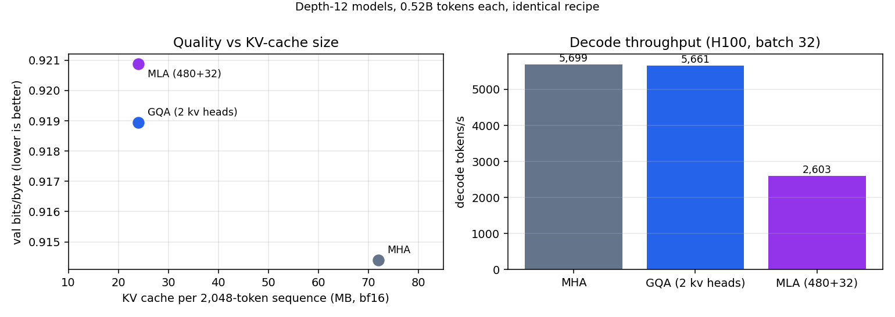
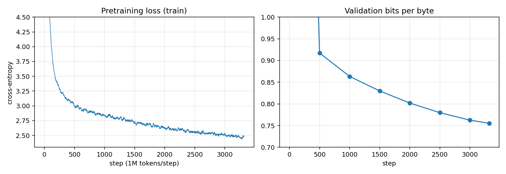
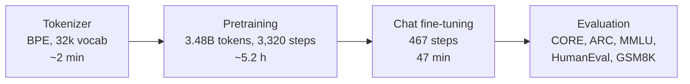

# nanochat-d20 — a chat model trained from scratch

A 20-layer GPT-style chat model trained **entirely from scratch** on a single H100: its own BPE tokenizer,
~5 hours of pretraining on 3.5B tokens, 47 minutes of chat fine-tuning and 42 minutes of reinforcement learning. No pretrained weights were used at any
stage. Built with [karpathy/nanochat](https://github.com/karpathy/nanochat); this repo holds the training run,
benchmarks, an attention-architecture experiment (MLA vs GQA vs MHA), deployment and the operational tooling around it.

**[Chat with it (Hugging Face Space)](https://huggingface.co/spaces/sumitkClasses/scratchq-110)** ·
**[Model weights](https://huggingface.co/sumitkClasses/nanochat-d20-chat)** ·
[Training scripts](nanochat-d20/scripts) · [Benchmarks](nanochat-d20/results/benchmarks.json)

> The free CPU Space streams a few words per second. On a GPU the same model answers at ~50 tokens/s.

## Results

All numbers come from nanochat's own evaluation code (commit `92d63d4`), so they are directly comparable with the
reference nanochat d20 run (Oct 2025), which trained the same depth on ~3x more tokens (11.2B vs 3.5B).

| Benchmark | What it tests | **This model** | nanochat d20 reference | Random guessing |
|---|---|---:|---:|---:|
| CORE (22 tasks, base model) | broad knowledge, reasoning, reading comprehension | **0.236** ¹ | 0.222 | 0.0 |
| ARC-Easy | grade-school science, multiple choice | **55.2%** | 38.8% | 25% |
| ARC-Challenge | harder science, multiple choice | **42.9%** | — | 25% |
| MMLU (57 subjects) | general knowledge, multiple choice | **35.2%** | 31.5% | 25% |
| HumanEval | writing Python functions (pass@1) | **11.0%** | 8.5% | 0% |
| GSM8K, after chat tuning | grade-school math word problems | 1.5% ² | 4.6% | 0% |
| **GSM8K, after RL** | same 400 problems | **10.0%** ² | 7.6% | 0% |

CORE against GPT-2, scored with the same harness and settings:

| Model | Parameters | CORE |
|---|---:|---:|
| GPT-2 small | 124M | 0.123 |
| GPT-2 medium | 355M | 0.192 |
| **nanochat-d20** | 897M total, 393M transformer | **0.236** |
| GPT-2 XL (published) | 1.5B | 0.257 |

ARC/MMLU after RL: 55.4% / 43.9% / 35.2% (no regression).
¹ 500 examples per CORE task (nanochat's in-training setting) rather than every example, so treat it as an estimate.
² First 400 of the 1,319 test problems. Multi-step arithmetic is the weakest area at this size.

**Compared with the original nanochat d20 baseline.** Same depth, trained on ~3× fewer tokens (3.5B vs 11.2B) using the
current nanochat recipe, it scores higher on every benchmark above except GSM8K before RL, and higher on GSM8K after RL.
The gains come from nanochat's newer recipe; my work was configuring and budgeting the run, evaluating it against GPT-2
with the same harness, the RL stage, implementing multi-head latent attention for an attention ablation, and the
training and serving infrastructure around it.

Per-task CORE scores and the full logs are in [`nanochat-d20/results/`](nanochat-d20/results).

## Architecture experiment: KV-cache-efficient attention (MHA vs GQA vs MLA)

Serving cost is dominated by the KV cache: every token of every conversation stores keys and values in every layer,
which caps how many users fit on a GPU and how long contexts can be. I implemented **multi-head latent attention
(MLA, DeepSeek-V2)** in nanochat, which does not ship it, and ran a controlled ablation against standard multi-head
attention (MHA) and grouped-query attention (GQA), with GQA and MLA given the **same KV-cache budget**.

- **MLA implementation** ([`nanochat-d20/mla/mla.patch`](nanochat-d20/mla/mla.patch), ~260 lines): keys and values are
  reconstructed from a shared 480-dim latent, position goes through a separate 32-dim RoPE key shared by all heads, and
  only those 512 numbers per token per layer are cached (vs 1,536 for MHA). The generation engine stores the compact
  latent. Unit tests check that token-by-token cached decoding reproduces the full-sequence forward pass exactly for all
  three variants, including sliding-window layers.
- **Setup**: depth 12 (768 wide, 6 heads × 128), 1,000 steps × 524,288 tokens (0.52B tokens), bf16, same data order, seed,
  optimizer and schedule for all three; value embeddings disabled in all three because they bypass the KV path.

| Variant | KV cache per 2,048-token sequence | Sequences in a 10 GB cache | Val bits/byte ↓ | CORE | Decode tok/s (batch 1 / 32) |
|---|---:|---:|---:|---:|---:|
| MHA (6 kv heads) | 72 MB | 142 | **0.9144** | **0.128** | 180 / 5,699 |
| GQA (2 kv heads) | 24 MB | 426 | 0.9189 | 0.106 | 178 / 5,661 |
| MLA (480 latent + 32 RoPE) | 24 MB | 426 | 0.9209 | 0.099 | 89 / 2,603 |



**Findings**

1. Cutting the KV cache 3× (3× more concurrent 2k-token sequences per GPU) cost about 0.5–0.7% in validation loss.
2. At equal cache size, MLA did not beat GQA at this scale; the 0.002 bits/byte gap is within single-seed noise, so the
   two are effectively tied here. DeepSeek reports MLA ahead at much larger scale; this run tuned no MLA-specific
   hyperparameters (latent width, learning rates).
3. MLA decoded about 2× slower. nanochat applies QK-norm to full keys, which blocks MLA's weight-absorption trick
   (folding the key up-projection into the query), so cached latents are re-expanded to keys and values every step.
   Making MLA fast here would need QK-norm moved onto the latent or removed, a stability trade-off worth its own study.

Limitations: one seed per variant, a small model and a short run; CORE at this size is noisy, so validation bits/byte
is the primary metric. Logs and raw results: [`nanochat-d20/results/ablation/`](nanochat-d20/results/ablation).

## What talking to it looks like

Real, unedited outputs (temperature 0.6):

> **Explain photosynthesis to a 10 year old.**
> Plants, like animals, make their food using sunlight, water, and soil. They take in sunlight, which is like a big,
> super powerful sunbeam that helps them make their own food… They use sunlight to make sugar, which is like a super
> special kind of sugar that plants use to make their food.

> **Give me three tips for a job interview.**
> When preparing for a job interview, there are several key tips to keep in mind. First, research the company
> thoroughly. Understand their mission, values, and recent news… Second, practice common interview questions…

> **Write a short poem about the monsoon.**
> Silent rain of monsoons, / A gentle breeze that stirs hearts, / … / The monsoon's rhythm, a heartbeat, a pulsing
> sound, / A reminder of life's enduring power.

It is fluent and stays on topic, but it **confidently invents facts** (asked about New Delhi, it described a
"City of Red Ghats" and an "Indian Civil War"). That is expected for a model of this size and training budget.

## The model

| | |
|---|---|
| Architecture | nanochat GPT: 20 layers, width 1280, 10 heads, RoPE, QK-norm, sliding-window + full attention (`SSSL`), 2,048-token context |
| Parameters | 897M total: ~393M transformer weights + ~503M embedding tables (token + per-layer value embeddings) |
| Tokenizer | 32,768-token BPE, trained from scratch on ~2B characters of the pretraining data |
| Pretraining | 3.48B tokens of NVIDIA ClimbMix, 3,320 steps × 1M tokens, Muon + AdamW, FP8 matmuls, ~5.2 h on 1× H100 |
| Chat fine-tuning | 467 steps on SmolTalk conversations mixed with MMLU (×3) and GSM8K (×4), 47 min |
| Final loss | 0.755 bits/byte (pretraining val) · 0.296 bits/byte (chat val) |



## Training pipeline

End-to-end training took about 7 hours on a single H100 SXM. Pretraining and chat fine-tuning ran from one script
([`run_d20.sh`](nanochat-d20/scripts/run_d20.sh)):



| Stage | Details | Wall-clock |
|---|---|---:|
| Tokenizer | BPE trained on ~2B characters of the pretraining data | ~2 min |
| Pretraining | d20, data:param ratio 8, 1M-token batches, FP8, ~197k tokens/s | ~5.2 h |
| Chat fine-tuning | SmolTalk + MMLU (×3) + GSM8K (×4), ~790k rows, one epoch | 47 min |
| RL on GSM8K | 75 steps × 16 problems × 16 samples, reward = correct final answer | 42 min |

- **Checkpointing.** Model and optimizer state were uploaded to a private Hugging Face repo every 500 steps
  (~45 min), so training could resume from the last upload after a host failure.
- **Automatic teardown.** The GPU instance shuts itself down after the final upload or at a hard time limit.
- **Reproducibility.** Chat fine-tuning was run twice from the same base checkpoint and reached the same validation
  loss both times (0.2961 bits/byte).
- **Reinforcement learning.** nanochat's GRPO-style REINFORCE (group-mean baseline, no KL term) on GSM8K. The step count
  was capped at 75 with the learning-rate decay rescaled to match; mean reward rose from 4% to 25% and answers shortened
  from 260 to 169 tokens.

## Serving

[`nanochat-d20/serve/app.py`](nanochat-d20/serve/app.py) is one file that serves both a Gradio chat UI and an
**OpenAI-compatible API** (`/v1/models`, `/v1/chat/completions` with streaming):

| Where | Hardware | Speed |
|---|---|---|
| Hugging Face Space (public demo) | free 2-vCPU CPU | ~7 tokens/s |
| Apple Silicon Mac | CPU, 2 threads | ~24 tokens/s |
| On-demand GPU | RTX A4000 class, boots in ~4 min | ~53 tokens/s |

The on-demand GPU sits behind a small self-hosted control plane: a password-protected page launches the box, a
fixed HTTPS endpoint relays OpenAI-style requests to whichever instance is live (so clients never reconfigure), and
the box is destroyed automatically after 45 idle minutes.

int8 dynamic quantization was tested for the CPU demo and rejected: on an Apple Silicon CPU it ran at 13.7 tok/s
vs 16.2 for fp32 and lost about 6 points on ARC-Easy (48.0% vs 54.2%).

## Reproduce

```bash
# on a fresh 1x H100 box, with HF_TOKEN in /root/.hf_token
bash nanochat-d20/scripts/run_d20.sh        # tokenizer → pretrain → SFT → samples → upload → self-destroy
bash nanochat-d20/scripts/run_eval.sh       # CORE + HumanEval + GSM8K on any >=10 GB GPU
bash nanochat-d20/scripts/run_rl.sh         # RL on GSM8K from the chat checkpoint, then GSM8K/ARC/MMLU
bash nanochat-d20/scripts/run_ablation.sh   # MHA vs GQA vs MLA at depth 12 (needs nanochat + mla.patch)
```

Talk to the released weights locally:

```bash
git clone https://github.com/karpathy/nanochat && cd nanochat && git checkout 92d63d4 && uv sync --extra cpu
uvx --from huggingface_hub hf download sumitkClasses/nanochat-d20-chat --local-dir ~/.cache/nanochat
NANOCHAT_BASE_DIR=$HOME/.cache/nanochat .venv/bin/python -m scripts.chat_cli
```

## Repository layout

```
nanochat-d20/
  scripts/   run_d20.sh (full unattended run), run_sft.sh (SFT-only re-run), run_eval.sh, run_rl.sh,
             upload.py / upload.sh (checkpoint streaming to the Hub)
  serve/     app.py + requirements.txt (Gradio UI + OpenAI-compatible API, deployed to the Space)
  mla/       mla.patch: multi-head latent attention + GQA switches + KV-cache benchmark for nanochat 92d63d4
  results/   benchmarks.json, pretraining_curves.png, sample chats, full training/eval logs, ablation/
experiments/
  scratchq-110m/   earlier experiment: a 110M model on a hand-written PyTorch training stack
```

## Limitations

- Hallucinates facts confidently; do not use it as a source of truth.
- Weak at arithmetic and multi-step reasoning (GSM8K 10% after RL).
- 2,048-token context, English only, and it forgets details from earlier turns.
- Not safety-tuned beyond what the public SmolTalk data provides.

## Acknowledgements

[nanochat](https://github.com/karpathy/nanochat) by Andrej Karpathy (MIT) provides the model, optimizer and training
code; this project trains, evaluates, ships and operates a d20 model with it. Data: NVIDIA ClimbMix, HuggingFace
SmolTalk, MMLU, GSM8K; evaluation sets from the DCLM CORE suite, ARC, MMLU, HumanEval and GSM8K.
